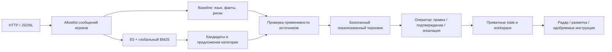

> Исторический документ. Текущие проверки и ограничения кандидата 0.3.0 перечислены в [checkpoint-status](checkpoint-status.md); прежние числа не заменяют итоговую проверку.

# Архитектура Support Intelligence v2

Node 22/ESM, стандартный HTTP-сервер и vanilla UI. Общее детерминированное ядро `src/core/` сохранено как baseline. `src/intelligence/` добавляет локальный E5 int8, гибридный поиск и консервативное уточнение категории. Веса устанавливаются отдельно; без них работает явный fallback. Никаких внешних модельных API в inference нет.

Admin-сообщения, исходы и исторические метки не входят в inference. Оба arm оценки получают одинаковый безопасный вход. Пользовательский номер правила не становится цитатой: canonical ID включает раздел и пункт, текст проверяется по корпусу. Глобальные кандидаты и одобренные инструкции отображаются отдельно от официальных цитат.

E5 работает в отдельном Node child process: отмена нативного ONNX не завершает основной HTTP-процесс. Один inference slot, ограниченная длина и timeout; загрузка/индексирование — отдельное задание. Индекс имеет проверяемые checkpoints. Неудачный/занятый поиск возвращает явно отмеченный baseline/lexical fallback.

Экспериментальный Qwen/llama.cpp выключен по умолчанию. После независимого review свободный модельный текст закрыт: JSON grammar и отдельный валидатор допускают только выбор проверенных локализованных формулировок. Это ограниченная генерация, не свободное сочинение. Canonical citations добавляются детерминированным wrapper. Перед запуском проверяется RAM, E5 выгружается, native generator завершается, затем E5 восстанавливается. Никакой ответ модели не отправляется игроку автоматически.

`runtime/state.json` хранит очередь/правки/feedback, `runtime/workspace.json` — задания, разметку, сравнения, радар и историю шаблонов. Запись атомарная с fsync. Радар использует общие семантически найденные источники и близость текста, а не прямой cosine ticket embeddings; семьи платежей и аккаунтов разделены. Группа не подтверждает инцидент. Изменение одобренной инструкции возвращает её на рассмотрение; отзыв сразу исключает её из поиска.

Метрики имеют provenance и числители/знаменатели. Нет gold — нет accuracy. Агентская синтетика не заменяет экспертную оценку. Обучение по правкам автоматически не запускается; notebook — отдельный выключенный эксперимент с авторскими данными и разбиением по сценариям.

Границы доступа: loopback, Host/Origin, CSP, ограниченный JSON/body/import, безопасный textContent и отсутствие пользовательских путей/команд в HTTP. Промышленная авторизация и отправка в игру вне MVP. Приватные данные, модели, checkpoints и реальные предсказания исключены из Git/npm по строгому allowlist; опубликован только код и агрегаты. Native модели скачиваются из закреплённых официальных источников отдельно.
Один владелец runtime защищает state и workspace от второго сервера/CLI. Marker содержит PID, hostname и идентификатор запуска; неизвестный/чужой владелец блокирует запись. После SIGKILL прежнего запуска на том же хосте checkpoint восстанавливается. Перенос между хостами/пересозданными контейнерами требует проверки прежнего владельца перед ручным восстановлением; активную блокировку нельзя удалять.
